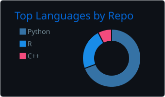

# Hey, I'm Kaleb Coleman 👋

### Digital twins of robotic systems | M.S. AI Engineering (Robotics) at ASU | Research with the RISE Lab

---

## About Me

I build digital twins of robotic systems in simulation: a Unitree G1 humanoid, a UR5e arm doing contact-rich assembly, and quadrotors, in NVIDIA Isaac Sim, Isaac Lab, and MuJoCo. I also build the tools that let AI agents work in those simulators.

I am a master's student at Arizona State University in Artificial Intelligence Engineering with a focus on robotics, doing research with the RISE Lab. I graduated from Northern Arizona University with a B.S. in Data Science and a minor in Cybersecurity, so my work sits where data science meets robotics: machine learning and data pipelines on one side, simulation, control, and autonomous systems on the other.

I care about reproducible, honestly reported results: every claim should trace to a run, a log, or a saved artifact, and limitations get written down next to the numbers.

---

## Digital Twins Across Systems

Each project below is the simulation side of a twin: a physics model of a real robot, with measured results and written limits. **Long-term goal:** data-informed digital twins that connect real robots and simulation to improve models and control. That sim-to-real loop is the direction of my research, not something already built. Everything shown below ran in simulation, and none of it is physically calibrated.

### G1 Locomotion Lab

**[g1-locomotion-lab](https://github.com/kalebcoleman/g1-locomotion-lab)** | *Simulation demo complete; fall-recovery research ongoing*

- **Built:** trained a simulated Unitree G1 walking policy using Isaac Lab's existing velocity task and PPO setup on Newton/MuJoCo-Warp, then wrote the evaluation and reporting around it: a scripted stand, walk, turn, and stop test with random pushes, a sweep across saved checkpoints, and a study of when and where robots fall. The task, rewards, and PPO are upstream components, not a new algorithm of mine.
- **Demonstrated:** 237 of 256 simulated robots stayed up through the 24-second pushed test in the published evaluation (two reruns gave 231 and 233), with turning the most common point of failure. This is one policy from one training seed, not a general reliability claim.
- **Working toward:** fall recovery. Recent get-up results still need revalidation for physical plausibility, so I do not count that problem as solved.

Same scripted commands at training iteration 0 (left) and 1499 (right), 16 simulated robots per side. There are no pushes in this clip and robots that fall are reset in place, so it is not footage of the 256-robot test. G1 model by Unitree Robotics, rendered with Isaac Lab and Isaac Sim.

### Contact Assembly Lab

**[contact-assembly-lab](https://github.com/kalebcoleman/contact-assembly-lab)** | *Simulation testbed; real-robot comparison and Jenga research ongoing*

- **Built:** a contact-rich robotic assembly testbed in Isaac Sim 6.2. A UR5e with an RG2 gripper assembles structures from interlocking parts while a joint-strength model decides, at every physics step, whether each connection holds. My work is the Isaac Sim 6.2 port, a weld-torque correction for PhysX 5.9's CPU TGS solver, the assembly controller, a library of 29 structures, reproducible sweeps, and a run dashboard. It builds on [BrickSim](https://github.com/intelligent-control-lab/BrickSim) by the [Intelligent Control Lab](https://github.com/intelligent-control-lab) ([paper](https://arxiv.org/abs/2603.16853)), whose connection and breakage physics it uses.
- **Demonstrated:** 21 of the 29 [catalogued structures](https://github.com/kalebcoleman/contact-assembly-lab/blob/main/docs/STRUCTURES.md) complete in simulation at their saved settings, and repeated runs gave identical results on the reference machine. The other 8, including two cantilever break tests designed to fail, do not, and the [failure analysis](https://github.com/kalebcoleman/contact-assembly-lab/blob/main/experiments/ur5e_structures/FAILURES.md) says where and why. A completed run is one deterministic run, not evidence of robustness, and no real-robot trials have been run.
- **Working toward:** more ways to grip parts, building the same structures on the real UR5e to compare what fails, and carrying the evaluation methods over to Jenga manipulation, potentially with MPC or RL. The Jenga work is ongoing research in private repositories, and none of it is solved yet.

 

Left: the seven-part arch bridge at the end of its simulated build. Right: the run dashboard listing all 29 structures. Simulation only, rendered in Isaac Sim 6.2.

### Twinsmith

**[twinsmith](https://github.com/kalebcoleman/twinsmith)** | *Source version 0.3.0*

- **Built:** an MCP server an AI agent uses to build and drive robot simulations and digital twins: scenes, cameras and LiDAR, robot import and motion, and Isaac Lab training and evaluation, with Newton (MuJoCo-Warp) as the default engine for the scenes it builds, switchable toolsets and a `status` tool, asset packs kept outside the repository, a RoboSimStudio real-to-sim bridge, and a UR5e Jenga work cell. The default tool list is 31 tools and 15,178 estimated tokens, down from about 28,450 before toolsets. The UR5e work cell began as a fork of Aldrin Inbaraj's [isaac-sim-mcp](https://github.com/inbarajaldrin/isaac-sim-mcp); the bridge and client were first built on his [omni-kit-mcp](https://github.com/inbarajaldrin/omni-kit-mcp) and rewritten here.
- **Demonstrated:** the example scenes and training runs in [Examples](https://github.com/kalebcoleman/twinsmith/blob/main/docs/EXAMPLES.md) are captures from live runs, with a record of how each was made. They illustrate the tools and are not benchmarks. The UR5e Jenga work cell is a candidate; runtime qualification is still open.
- **Compatibility:** Linux x86_64 (Ubuntu 24.04 or 22.04). Newton is the default engine for the scenes these tools build; PhysX is opt-in, and the UR5e work cell runs on PhysX only. The claimed builds are Isaac Sim 6.2.0.0 with Isaac Lab 3.0.0, and Isaac Sim 5.1.0.0 with Isaac Lab 2.3.2. Isaac Sim 5.1 has no Newton, so that pairing is PhysX only. See the [compatibility matrix](https://github.com/kalebcoleman/twinsmith/blob/main/docs/COMPATIBILITY.md).

A warehouse built by one `sim__quick_start environment=warehouse` call. The walls, racks, and cargo are boxes authored by the tool; the wheeled robot is NVIDIA's public Carter model.

### Energy-Aware Prescribed-Time Quadrotor Control

*Team research with John Lok, ongoing, simulation only*

- **What we are studying:** nonlinear and prescribed-time quadrotor control, including runtime, parameter sensitivity, and modeled energy.
- **My part:** John led the controller development. I reproduced an archived MuJoCo NMPC baseline and am running a timing and validation study that is still in progress.
- **Working toward:** hardware validation at ASU Drone Studio. This is planned; the work so far is simulation only.
- **Background:** [Robust Optimal Agile Flight of Quadrotors (IM-NMPO)](https://doi.org/10.1109/TRO.2026.3721737) and [Prescribed-Time Trajectory Tracking Control for Quadrotor Without Velocity Measurement](https://doi.org/10.1109/TMECH.2025.3547788).

The collaborative code is in a private repository. I am happy to talk through the work on request.

---

## Featured Public Repositories

**Robotics**

- **[g1-locomotion-lab](https://github.com/kalebcoleman/g1-locomotion-lab):** training and evaluating simulated Unitree G1 locomotion in Isaac Lab with Newton/MuJoCo-Warp; 237 of 256 robots stayed up through the published pushed test.
- **[contact-assembly-lab](https://github.com/kalebcoleman/contact-assembly-lab):** contact-rich robotic assembly testbed in Isaac Sim 6.2, with a UR5e, joint-strength physics, and a catalog of 29 structures.
- **[twinsmith](https://github.com/kalebcoleman/twinsmith):** MCP server for building robot simulations and digital twins in Isaac Sim and Isaac Lab, with Newton (MuJoCo-Warp) as the default engine, a RoboSimStudio real-to-sim bridge, switchable toolsets and a status tool (default list 15,178 estimated tokens, down from about 28,450), external asset packs, and a UR5e Jenga work cell.

**Data science**

- **[nba-modeling](https://github.com/kalebcoleman/nba-modeling):** leakage-aware NBA win modeling with time-ordered validation, a reproducible `targets` pipeline, and predictions logged before tip-off. On the one 2025-26 test season, the best model picked 68.6% of games correctly (95% interval 66.2% to 71.2%), against 55.4% for always picking the home team and 67.9% for Elo ratings alone. [Site](https://kalebcoleman.github.io/nba-modeling/) and [paper](https://kalebcoleman.github.io/nba-modeling/paper/paper.pdf).
- **[nau-capstone](https://github.com/kalebcoleman/nau-capstone):** NAU team capstone comparing shot quality and expected scoring across the NBA and NHL, with a Streamlit dashboard and [research poster](https://kalebcoleman.github.io/static/nau-capstone-poster.pdf).

<b>More projects</b>

 

- [nba-data](https://github.com/kalebcoleman/nba-data): R package that collects ESPN NBA game data and keeps a versioned SQLite database current during the season.
- [datafest-2026](https://github.com/kalebcoleman/datafest-2026): my team's ASA DataFest project on patient journeys and healthcare utilization.
- [halma-ai](https://github.com/kalebcoleman/halma-ai): Halma game AI using iterative-deepening minimax with alpha-beta pruning.
- [ImageReconstruction](https://github.com/kalebcoleman/ImageReconstruction): older CS 472 coursework with DDPM diffusion models on MNIST and CIFAR-10 and autoencoder baselines.

---

## Featured Work

- Trained a simulated Unitree G1 walking policy and evaluated it with a scripted pushed test: 237 of 256 robots stayed up in the published run (231 and 233 in reruns), from one policy and one training seed.
- Ported a contact-rich assembly simulator to Isaac Sim 6.2 and built a UR5e controller, structure catalog, and failure analysis on it: 21 of 29 structures complete in simulation.
- My team received the **Best Visualization Award** at NAU's ASA DataFest 2026 for work on early signals of high healthcare utilization.
- Built a leakage-aware NBA win model and an ESPN data pipeline in R. Most of the signal is in the Elo ratings: the interval for the AUC gain from adding rolling features includes zero. With the 2025-26 test season now seen, 2026-27 predictions logged before each game and scored on the [live page](https://kalebcoleman.github.io/nba-modeling/live.html) are the only untouched test.
- Worked with Kanaan Law and Drianna Walker on our NAU capstone's NBA/NHL shot-quality analysis ([research poster](https://kalebcoleman.github.io/static/nau-capstone-poster.pdf)) and Streamlit dashboards to communicate results.
- Trained models on university HPC clusters with Slurm and on other GPU resources.

---

## Sites

| Site | What it is |
| --- | --- |
| [Portfolio](https://kalebcoleman.github.io/) | Projects, current research focus, and resume. |
| [NBA win modeling](https://kalebcoleman.github.io/nba-modeling/) | Results, methods, and a live page for the 2026-27 season. Each game day the pipeline logs a home-win probability for every game before tip-off, then scores the games once they finish. The [paper is a PDF](https://kalebcoleman.github.io/nba-modeling/paper/paper.pdf). |
| [Image reconstruction](https://kalebcoleman.github.io/ImageReconstruction/) | Older CS 472 coursework: diffusion samples on MNIST and CIFAR-10, with autoencoder baselines. |

---

## Technical Skills

- **Programming languages:** Python, R, C, SQL.
- **Tools and libraries:** PyTorch, scikit-learn, XGBoost, pandas and NumPy, NVIDIA Isaac Sim and Isaac Lab, Newton and MuJoCo-Warp, MuJoCo, Streamlit, PostgreSQL and SQLite, Linux, Git and GitHub.
- **Robotics skills:** digital twins in simulation, USD scene authoring, UR5e/RG2 manipulation and contact-rich assembly in simulation, inverse kinematics, PPO training and policy evaluation (rsl_rl), MCP-based simulator tooling, Linux/GPU workstation setup.
- **Areas of interest:** robotics and manipulation, control and optimization, digital twins and sim-to-real, deep learning, computer vision, data engineering, cybersecurity.

---

## What I'm Working Toward

**Now:** doing research with the RISE Lab, working on a higher-fidelity UR5e workcell and Jenga manipulation, researching fall recovery for simulated humanoids, and studying quadrotor control with John Lok ahead of planned hardware validation.

**Long term:** data-informed digital twins that connect real robots and simulation to improve models and control.

**Next:** completing my M.S. at ASU, aimed at sim-to-real transfer, learning-based and optimal control, drones, and space systems.

---

## Hobbies

Outside of school and coding, I enjoy sports, gaming, technology, learning about AI, and working on projects that help me grow as a developer and researcher.

---

## Languages and Tools

---

## GitHub Stats

---

## Connect With Me

- LinkedIn: [Kaleb Coleman](https://www.linkedin.com/in/kalebacoleman/)
- GitHub: [kalebcoleman](https://github.com/kalebcoleman)
- Portfolio: [kalebcoleman.github.io](https://kalebcoleman.github.io/)
- X: [@kalebcoIeman](https://x.com/kalebcoIeman)
