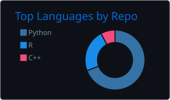

# Hey, I'm Kaleb Coleman 👋

### Digital twins of robotic systems | M.S. AI Engineering (Robotics) at ASU | Research with the RISE Lab

---

## About Me

I work on perception, simulation, and control for robotic systems: reconstructing scenes in NVIDIA Isaac Sim from real UR5e wrist-camera recordings, studying quadrotor trajectory control, and training a simulated Unitree G1. I also build the tools that let AI agents work in those simulators.

I am a master's student at Arizona State University in Artificial Intelligence Engineering with a focus on robotics, doing research with the RISE Lab. I graduated from Northern Arizona University with a B.S. in Data Science and a minor in Cybersecurity, so my work sits where data science meets robotics: machine learning and data pipelines on one side, simulation, control, and autonomous systems on the other.

I care about reproducible, honestly reported results: every claim should trace to a run, a log, or a saved artifact, and limitations get written down next to the numbers.

---

## Digital Twins Across Systems

Each project below is the simulation side of a twin: a physics model of a real robot, with measured results and written limits. **Long-term goal:** take a prediction or plan from the twin back to the physical robot. That return trip is not validated. Real wrist-camera recordings are an input to the UR5e reconstruction. Robot motion shown below ran in simulation, and none of it is physically calibrated.

### Twinsmith

**[twinsmith](https://github.com/kalebcoleman/twinsmith)** | *UR5e digital twin; source version 0.3.0, installed from source*

- **What works today:** real UR5e wrist-camera recordings are matched to part poses and rebuilt in Isaac Sim (Newton). On one still clip of five loose parts, all five matched and the rebuilt scene settled by at most 0.1 mm. That clip has no independent ground truth, and stacked or leaning layouts are only partly solved. Write-up: [Scan to scene](https://github.com/kalebcoleman/twinsmith/blob/main/exts/workcell/workcell/README.md#scan-to-scene).
- **A component benchmark, not a full cycle:** the project cut mean single-process read-and-match time from 11.64 s to 5.63 s across 29 recorded clips, with unchanged pose estimates on that set. [Pull request 152](https://github.com/kalebcoleman/twinsmith/pull/152).
- **Not shown:** sending a plan from that twin back to the physical UR5e. The simulated assembly that uses these estimates cannot command the real arm.
- **Also in the repo:** an MCP server for building and driving Isaac Sim and Isaac Lab scenes. A client sees 6 core tools by default (about 1,586 estimated tokens) until more toolsets are switched on. The UR5e work cell began as a fork of Aldrin Inbaraj's [isaac-sim-mcp](https://github.com/inbarajaldrin/isaac-sim-mcp).

A simulated UR5e driven to a target through twinsmith. This frame is a commanded pose, not a reconstruction from a real wrist-camera image.

### Energy-Aware Prescribed-Time Quadrotor Trajectory Following

*Team research with John Lok. Figures below are from the team's Nov 16, 2026 project update. Simulation only, not a final report.*

- **John Lok led controller development.** My part: team organization and presentations, reproducing an archived MuJoCo NMPC baseline on a lab PC, and a timing and validation study. Controller design and the success counts are the team's.
- **300 paired randomized S500 simulations:** 205 (68.3%) fixed inertia, 224 (74.7%) torque term only, and 248 (82.7%) full adaptation. A success does not crash, meets the deadline test at the controller-certified deadline, and stays within 20 cm of the path afterward.
- **Timing, kept separate, and not a real-time guarantee:** submitted Colab p95 control step was 50.6 ms, over a 20 ms budget. Separate desktop workstation runs were 12.0–13.2 ms p95. A later Colab rerun was 39.2–42.0 ms. These will be timed on a flight computer.
- **Working toward:** hardware hover and tracking tests at the ASU Drone Studio. Nothing has flown, and there is no measured battery saving.

The collaborative code is in a private repository. I am happy to talk through the work on request.

### G1 Locomotion Lab

**[g1-locomotion-lab](https://github.com/kalebcoleman/g1-locomotion-lab)** | *Simulation demo complete; fall-recovery research ongoing*

- **Built:** trained a simulated Unitree G1 walking policy using Isaac Lab's existing velocity task and PPO setup on Newton/MuJoCo-Warp, then wrote the evaluation and reporting around it: a scripted stand, walk, turn, and stop test with random pushes, a sweep across saved checkpoints, and a study of when and where robots fall. The task, rewards, and PPO are upstream components, not a new algorithm of mine.
- **Demonstrated:** 237 of 256 simulated robots stayed up through the 24-second pushed test in the published evaluation (two reruns gave 231 and 233), with turning the most common point of failure. This is one policy from one training seed, not a general reliability claim.
- **Fall-to-walk, simulation only:** 51.6% success (387 of 750 trials) with the recovery checkpoint and upper-body blend, against 28.7% (215 of 749) for the matched baseline with the same gate and blend. A fresh-seed repeat was 49.4%. [Results](https://github.com/kalebcoleman/g1-locomotion-lab/blob/main/docs/RESULTS.md). Nothing here has been tried on a physical G1.

Same scripted commands at training iteration 0 (left) and 1499 (right), 16 simulated robots per side. There are no pushes in this clip and robots that fall are reset in place, so it is not footage of the 256-robot test. G1 model by Unitree Robotics, rendered with Isaac Lab and Isaac Sim.

### Contact Assembly Lab

**[contact-assembly-lab](https://github.com/kalebcoleman/contact-assembly-lab)** | *Simulation testbed; real-robot comparison and Jenga research ongoing*

- **Built:** a contact-rich robotic assembly testbed in Isaac Sim 6.2. A UR5e with an RG2 gripper assembles structures from interlocking parts while a joint-strength model decides, at every physics step, whether each connection holds. My work is the Isaac Sim 6.2 port, a weld-torque correction for PhysX 5.9's CPU TGS solver, the assembly controller, a library of 29 structures, reproducible sweeps, and a run dashboard. It builds on [BrickSim](https://github.com/intelligent-control-lab/BrickSim) by the [Intelligent Control Lab](https://github.com/intelligent-control-lab) ([paper](https://arxiv.org/abs/2603.16853)), whose connection and breakage physics it uses.
- **Demonstrated:** 21 of the 29 [catalogued structures](https://github.com/kalebcoleman/contact-assembly-lab/blob/main/docs/STRUCTURES.md) complete in simulation at their saved settings, and repeated runs gave identical results on the reference machine. The other 8, including two cantilever break tests designed to fail, do not, and the [failure analysis](https://github.com/kalebcoleman/contact-assembly-lab/blob/main/experiments/ur5e_structures/FAILURES.md) says where and why. A completed run is one deterministic run, not evidence of robustness, and no real-robot trials have been run.
- **Working toward:** more ways to grip parts, building the same structures on the real UR5e to compare what fails, and carrying the evaluation methods over to Jenga manipulation, potentially with MPC or RL. The Jenga work is ongoing research in private repositories, and none of it is solved yet.

 

Left: the seven-part arch bridge at the end of its simulated build. Right: the run dashboard listing all 29 structures. Simulation only, rendered in Isaac Sim 6.2.

---

## Featured Public Repositories

**Robotics**

- **[twinsmith](https://github.com/kalebcoleman/twinsmith):** UR5e digital twin. Real wrist-camera clips are rebuilt in Isaac Sim; mean read-and-match time went from 11.64 s to 5.63 s on 29 clips ([benchmark](https://github.com/kalebcoleman/twinsmith/pull/152)). The return to the physical robot is not shown. Also an MCP server for Isaac Sim and Isaac Lab.
- **[g1-locomotion-lab](https://github.com/kalebcoleman/g1-locomotion-lab):** simulated Unitree G1 locomotion in Isaac Lab. Fall-to-walk success was 51.6% of 750 trials with the recovery checkpoint and upper-body blend, against 28.7% for the matched baseline ([results](https://github.com/kalebcoleman/g1-locomotion-lab/blob/main/docs/RESULTS.md)).
- **[contact-assembly-lab](https://github.com/kalebcoleman/contact-assembly-lab):** contact-rich robotic assembly testbed in Isaac Sim 6.2, with a UR5e, joint-strength physics, and a catalog of 29 structures.

**Data science**

- **[nba-modeling](https://github.com/kalebcoleman/nba-modeling):** leakage-aware NBA win modeling with time-ordered validation, a reproducible `targets` pipeline, and predictions logged before tip-off. On the one 2025-26 test season, the best model picked 68.6% of games correctly (95% interval 66.2% to 71.2%), against 55.4% for always picking the home team and 67.9% for Elo ratings alone. [Site](https://kalebcoleman.github.io/nba-modeling/) and [paper](https://kalebcoleman.github.io/nba-modeling/paper/paper.pdf).
- **[nau-capstone](https://github.com/kalebcoleman/nau-capstone):** NAU team capstone comparing shot quality and expected scoring across the NBA and NHL, with a Streamlit dashboard and [research poster](https://kalebcoleman.github.io/static/nau-capstone-poster.pdf).

<b>More projects</b>

 

- [TurtleBot3 ROS 2 sensing and Nav2 in Isaac Sim](https://kalebcoleman.github.io/projects/#turtlebot3-ros2-lidar): a RAS 545 course lab in simulation: LiDAR, camera, odometry and TF over ROS 2, checked in RViz, then AMCL localization and Nav2.
- [spatialSportsR](https://github.com/kalebcoleman/spatialSportsR): R package and Python analytics for NBA shot data, with xFG and GAM shot-quality models and a Streamlit dashboard.
- [nba-data](https://github.com/kalebcoleman/nba-data): R package that collects ESPN NBA game data and keeps a versioned SQLite database current during the season.
- [datafest-2026](https://github.com/kalebcoleman/datafest-2026): my team's ASA DataFest project on patient journeys and healthcare utilization.
- [halma-ai](https://github.com/kalebcoleman/halma-ai): Halma game AI using iterative-deepening minimax with alpha-beta pruning.
- [ImageReconstruction](https://github.com/kalebcoleman/ImageReconstruction): older CS 472 coursework with DDPM diffusion models on MNIST and CIFAR-10 and autoencoder baselines.
- [ai-multitool-assistant](https://github.com/kalebcoleman/ai-multitool-assistant): Django REST and React assistant with a ReAct agent on Google Gemini via LlamaIndex.
- [nau-course-scraping](https://github.com/kalebcoleman/nau-course-scraping): Selenium scraper for the NAU course catalog with an AI and ethics curriculum analysis.

---

## Featured Work

- Rebuilt scenes in Isaac Sim from real UR5e wrist-camera recordings. The project cut mean read-and-match time from 11.64 s to 5.63 s on 29 clips, with unchanged pose estimates. Taking a plan back to the physical robot is not yet shown.
- Team project with John Lok. The Nov 16, 2026 simulation update on prescribed-time quadrotor control reports 205, 224, and 248 successes out of 300 paired S500 flights for fixed inertia, torque term only, and full adaptation. John led controller development. Hardware tests are planned, and nothing has flown.
- In simulation, a Unitree G1 recovery checkpoint and upper-body blend reached 51.6% fall-to-walk success across 750 trials, against 28.7% for the matched baseline. The walking test kept 237 of 256 robots up (reruns 231 and 233), from one policy and one training seed.
- Ported a contact-rich assembly simulator to Isaac Sim 6.2 and built a UR5e controller, structure catalog, and failure analysis on it: 21 of 29 structures complete in simulation.
- My team received the **Best Visualization Award** at NAU's ASA DataFest 2026 for work on early signals of high healthcare utilization.
- Built a leakage-aware NBA win model and an ESPN data pipeline in R. Most of the signal is in the Elo ratings: the interval for the AUC gain from adding rolling features includes zero. With the 2025-26 test season now seen, 2026-27 predictions logged before each game and scored on the [live page](https://kalebcoleman.github.io/nba-modeling/live.html) are the only untouched test.
- Worked with Kanaan Law and Drianna Walker on our NAU capstone's NBA/NHL shot-quality analysis ([research poster](https://kalebcoleman.github.io/static/nau-capstone-poster.pdf)) and Streamlit dashboards to communicate results.
- Trained models on university HPC clusters with Slurm and on other GPU resources.

---

## Sites

| Site | What it is |
| --- | --- |
| [Portfolio](https://kalebcoleman.github.io/) | Projects, current research focus, and resume. |
| [NBA win modeling](https://kalebcoleman.github.io/nba-modeling/) | Results, methods, and a live page for the 2026-27 season. Each game day the pipeline logs a home-win probability for every game before tip-off, then scores the games once they finish. The [paper is a PDF](https://kalebcoleman.github.io/nba-modeling/paper/paper.pdf). |
| [Image reconstruction](https://kalebcoleman.github.io/ImageReconstruction/) | Older CS 472 coursework: diffusion samples on MNIST and CIFAR-10, with autoencoder baselines. |

---

## Technical Skills

- **Programming languages:** Python, R, C, SQL.
- **Tools and libraries:** PyTorch, scikit-learn, XGBoost, pandas and NumPy, NVIDIA Isaac Sim and Isaac Lab, Newton and MuJoCo-Warp, MuJoCo, Streamlit, PostgreSQL and SQLite, Linux, Git and GitHub.
- **Robotics skills:** digital twins in simulation, wrist-camera scene reconstruction, USD scene authoring, UR5e/RG2 manipulation and contact-rich assembly in simulation, inverse kinematics, PPO training and policy evaluation (rsl_rl), MCP-based simulator tooling, Linux/GPU workstation setup.
- **Areas of interest:** robotics and manipulation, control and optimization, digital twins and sim-to-real, deep learning, computer vision, data engineering, cybersecurity.

---

## What I'm Working Toward

**Now:** using real UR5e wrist-camera data to reconstruct scenes in Isaac Sim, with the longer-term goal of taking a plan back to the physical robot. That loop is not validated. I am also studying quadrotor control with John Lok ahead of planned hardware tests, and fall-to-walk for a simulated Unitree G1. My M.S. thesis direction, with Dr. Wenlong Zhang, is a real-to-sim-to-real UR5e that plays Jenga with a person. It is not built.

**Long term:** data-informed digital twins that connect real robots and simulation to improve models and control.

**Next:** completing my M.S. at ASU, aimed at sim-to-real transfer, learning-based and optimal control, drones, and space systems.

---

## Hobbies

Outside of school and coding, I enjoy sports, gaming, technology, learning about AI, and working on projects that help me grow as a developer and researcher.

---

## Languages and Tools

---

## GitHub Stats

---

## Connect With Me

- LinkedIn: [Kaleb Coleman](https://www.linkedin.com/in/kalebacoleman/)
- GitHub: [kalebcoleman](https://github.com/kalebcoleman)
- Portfolio: [kalebcoleman.github.io](https://kalebcoleman.github.io/)
- X: [@kalebcoIeman](https://x.com/kalebcoIeman)
